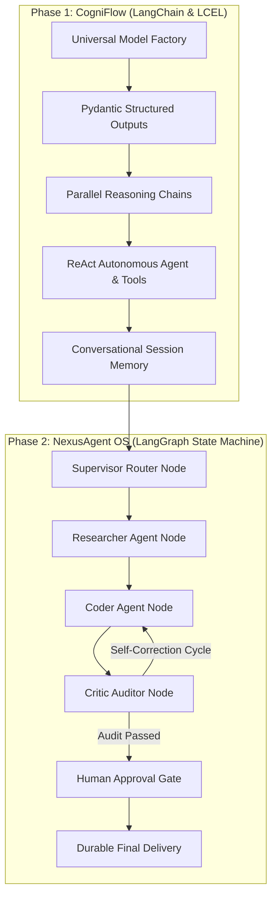

# 🧠 Autonomous Agentic Workflows & Multi-Agent OS (LC_LG)

A progressive, end-to-end production repository designed to master modern LLM application development, agentic workflows, and multi-agent coordination using **LangChain** and **LangGraph**.

---

## 📚 Zero-to-Hero Story Guides (Start Here!)
- 🍳 **[LangChain Basics Explained Like a Story](LC_BASICS.md)**: Understand the Chef, Recipe Card, and Conveyor Belt in 5 minutes with 0 jargon.
- 🕸️ **[LangGraph Basics Explained Like a Story](LG_BASICS.md)**: Understand State Machines, Nodes, Cycles, and Human-in-the-Loop using the 5-Star Restaurant team.

---

## 🏗️ Repository Architecture

This repository is divided into two progressive systems:



---

### 🔹 Phase 1: `cogniflow/` (LangChain Core & LCEL)
- **Universal LLM Factory**: Hot-swappable providers (Google Gemini, OpenAI, Groq) with automated fallback.
- **Structured Outputs**: Pydantic validation for research reports, fact-checks, and action plans.
- **LCEL Architecture**: Declarative chains using Unix-style pipes (`|`), `RunnableParallel`, and `RunnablePassthrough`.
- **Dynamic Tool Execution**: Tool bindings with live DuckDuckGo web search, Wikipedia lookup, and safe AST math evaluation.
- **Conversational Memory**: Session isolation using `RunnableWithMessageHistory`.
- **Interactive Rich CLI**: Terminal dashboard with formatted panels and status tables.

---

### 🔹 Phase 2: `nexus_agent/` (Autonomous Multi-Agent System with LangGraph)
- **Shared State Machine**: Central `AgentState` whiteboard using `TypedDict` and `add_messages` reducers.
- **Specialized Worker Nodes**:
  - 👑 **Supervisor Node**: Strategic goal decomposition and dynamic specialist dispatch.
  - 🔍 **Researcher Node**: Empirical fact-gathering and live context synthesis.
  - 💻 **Coder Node**: Modular Python code generation with self-healing bug patching.
  - 🧐 **Critic Node**: Strict numerical quality scoring (1.0 - 10.0) and automated issue detection.
  - 🛡️ **Human Gate Node**: Human-in-the-Loop (HITL) pause-and-resume approval mechanism.
- **Cyclic Self-Healing**: Conditional edges that loop flawed deliverables back to Coder/Researcher until quality criteria are satisfied.
- **State Persistence & Time-Travel**: SQLite & in-memory checkpointing saving thread history after every step.
- **Streaming Terminal Interface**: Real-time event streaming showing agent handoffs and auditor evaluations.

---

## 🚀 Quickstart

### 1. Environment Setup
```bash
conda activate genaienv
pip install -r requirements.txt
```

### 2. Environment Variables
Copy `.env.example` to `.env` and set your API keys:
```bash
cp .env.example .env
```
*(Supports Google Gemini free tier from [Google AI Studio](https://aistudio.google.com/), Groq, or OpenAI!)*

---

## 🎮 Running the Applications

### Run Phase 1: CogniFlow CLI (LangChain)
```bash
python -m cogniflow.cli
```

### Run Phase 2: NexusAgent OS CLI (LangGraph Multi-Agent Team)
```bash
python -m nexus_agent.cli
```

---

## 🧪 Testing & Verification

Run the full automated test suite (21 unit tests covering both systems):
```bash
pytest -v tests/
```
All 21 unit tests verify schema validation, safe tools, memory isolation, individual agent nodes, and end-to-end LangGraph execution!
