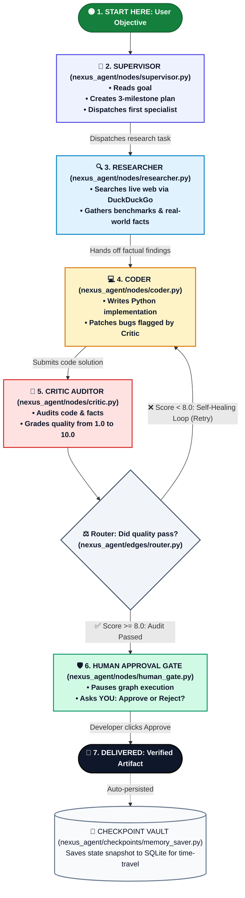
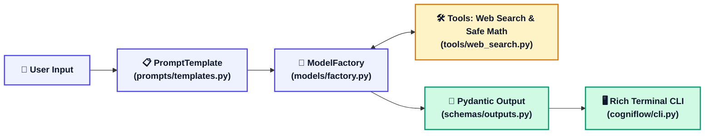

# 🧠 Autonomous Agentic Workflows & Multi-Agent OS (LC_LG)

A progressive, end-to-end production repository designed to master modern LLM application development, agentic workflows, and multi-agent coordination using **LangChain** and **LangGraph**.

---

## 📚 Zero-to-Hero Story Guides (Start Here!)
- 🍳 **[LangChain Basics Explained Like a Story](LC_BASICS.md)**: Understand the Chef, Recipe Card, and Conveyor Belt in 5 minutes with 0 jargon.
- 🕸️ **[LangGraph Basics Explained Like a Story](LG_BASICS.md)**: Understand State Machines, Nodes, Cycles, and Human-in-the-Loop using the 5-Star Restaurant team.

---

## 🗺️ How NexusAgent OS Works: The Visual Lifecycle

> 💡 **How to read this diagram**: Follow the numbers from **1️⃣ START** to **7️⃣ DELIVERED**! Every card shows the **exact Python file** responsible for that step.



---

## 🗂️ File-to-Role Cheat Sheet (What File Does What?)

If you are browsing the code, here is exactly where each piece lives and what it does:

| Step | File Path | Architectural Role | Plain-English Job Description |
|:---:|---|---|---|
| **Whiteboard** | [`nexus_agent/state/agent_state.py`](nexus_agent/state/agent_state.py) | **Central State** | The shared whiteboard dictionary holding all messages, drafts, scores, and logs. |
| **Step 1** | [`nexus_agent/nodes/supervisor.py`](nexus_agent/nodes/supervisor.py) | **👑 Supervisor** | The team manager. Decomposes the user prompt into milestones and decides who works next. |
| **Step 2** | [`nexus_agent/nodes/researcher.py`](nexus_agent/nodes/researcher.py) | **🔍 Researcher** | Gathers live data from the internet using DuckDuckGo search and Wikipedia. |
| **Step 3** | [`nexus_agent/nodes/coder.py`](nexus_agent/nodes/coder.py) | **💻 Coder** | Writes modular Python code. When the critic finds a bug, the coder rewrites and fixes it. |
| **Step 4** | [`nexus_agent/nodes/critic.py`](nexus_agent/nodes/critic.py) | **🧐 Critic Auditor** | Inspects code and facts, searches for bugs, and assigns a strict score (1.0 to 10.0). |
| **Step 5** | [`nexus_agent/edges/router.py`](nexus_agent/edges/router.py) | **🚦 Dynamic Router** | The crossroad. If score < 8.0, it routes back to Coder. If score ≥ 8.0, it proceeds to Human Gate. |
| **Step 6** | [`nexus_agent/nodes/human_gate.py`](nexus_agent/nodes/human_gate.py) | **🛡️ Human Gate** | Interrupts the autonomous run to let a real human inspect and approve before release. |
| **Storage** | [`nexus_agent/checkpoints/memory_saver.py`](nexus_agent/checkpoints/memory_saver.py) | **📸 Checkpointer** | Saves state history to SQLite after every node for resume capability and time-travel. |
| **Assembly** | [`nexus_agent/graph/builder.py`](nexus_agent/graph/builder.py) | **🕸️ Graph Builder** | Connects all nodes, conditional edges, and compile settings into a runnable state machine. |
| **Terminal** | [`nexus_agent/cli.py`](nexus_agent/cli.py) | **🚀 Interactive UI** | Beautiful Rich terminal application to run goals and view live streaming agent events. |

---

## ⚡ Step-by-Step Example Scenario: "Build a Vector DB Benchmark"

Here is what happens behind the scenes when you submit a real request to the system:

```text
1. 👤 YOU TYPE: "Analyze Pinecone vs Chroma, write a benchmark script, and verify it."

2. 👑 SUPERVISOR NODE:
   - Decomposes the goal into 3 milestones:
     [1] Gather latency and indexing specs for Pinecone & Chroma.
     [2] Write a Python benchmark script measuring queries per second.
     [3] Audit code for syntax errors and edge cases.
   - Assigns next worker: "researcher".

3. 🔍 RESEARCHER NODE:
   - Searches DuckDuckGo for: "Pinecone vs Chroma benchmark latency specs".
   - Saves empirical metrics and findings onto the shared whiteboard.
   - Hands off to: "coder".

4. 💻 CODER NODE (Draft 1):
   - Synthesizes a Python benchmark script using the retrieved latency numbers.
   - Submits draft to the whiteboard.
   - Hands off to: "critic".

5. 🧐 CRITIC AUDITOR NODE:
   - Evaluates the draft.
   - ⚠️ FOUND AN ISSUE: "Line 14 tries to parse latency as a string instead of float!"
   - Score: 6.5 / 10.0 (Status: FAILED).
   - 🔄 TRIGGERS SELF-HEALING LOOP: Routes back to "coder" with the exact bug traceback!

6. 💻 CODER NODE (Draft 2 - Self-Correction):
   - Reads the critic's bug description.
   - Casts latency to float(latency_ms) and adds exception handling.
   - Submits patched code to the whiteboard.

7. 🧐 CRITIC AUDITOR NODE (Re-Audit):
   - All tests pass! No syntax errors, facts verified.
   - Score: 9.2 / 10.0 (Status: APPROVED ✅).
   - Hands off to: "human_gate".

8. 🛡️ HUMAN APPROVAL GATE:
   - The autonomous system PAUSES completely.
   - Your terminal displays:
     "Audited deliverable ready (Score 9.2/10). Approve for release? [Y/n]:"
   - You type: "Y".

9. 🏁 RESULT:
   - The state is saved to the SQLite checkpoint vault.
   - The final, verified, bug-free deliverable is published to your terminal!
```

---

## 🍳 Phase 1 Overview: `cogniflow/` (LangChain Core)

Before moving to multi-agent graphs, the repository includes **CogniFlow**, demonstrating foundational LangChain primitives:



- **Universal LLM Factory**: Hot-swap between Google Gemini, OpenAI, and Groq without rewriting code.
- **Pydantic Structured Extraction**: Clean, typed JSON data models instead of unpredictable raw text.
- **LCEL Declarative Pipelines**: Chaining with `|`, `RunnableParallel`, and `RunnablePassthrough`.
- **Conversational Memory**: Isolated chat history sessions via `RunnableWithMessageHistory`.

---

## 🚀 Quickstart

### 1. Environment Setup
```bash
conda activate genaienv
pip install -r requirements.txt
```

### 2. Environment Variables
Copy `.env.example` to `.env` and set your API keys:
```bash
cp .env.example .env
```
*(Supports Google Gemini free tier from [Google AI Studio](https://aistudio.google.com/), Groq, or OpenAI!)*

---

## 🎮 Running the Applications

### Run Phase 2: NexusAgent OS (LangGraph Multi-Agent Team)
```bash
python -m nexus_agent.cli
```
*Choose Option 1 to watch the autonomous team stream live, or Option 2 to test the Human Approval Gate!*

### Run Phase 1: CogniFlow CLI (LangChain)
```bash
python -m cogniflow.cli
```

---

## 🧪 Testing & Verification

Run the full automated test suite (21 unit tests covering both systems):
```bash
pytest -v tests/
```
All 21 unit tests verify schema validation, safe tools, memory isolation, individual agent nodes, and end-to-end LangGraph state machine execution!
