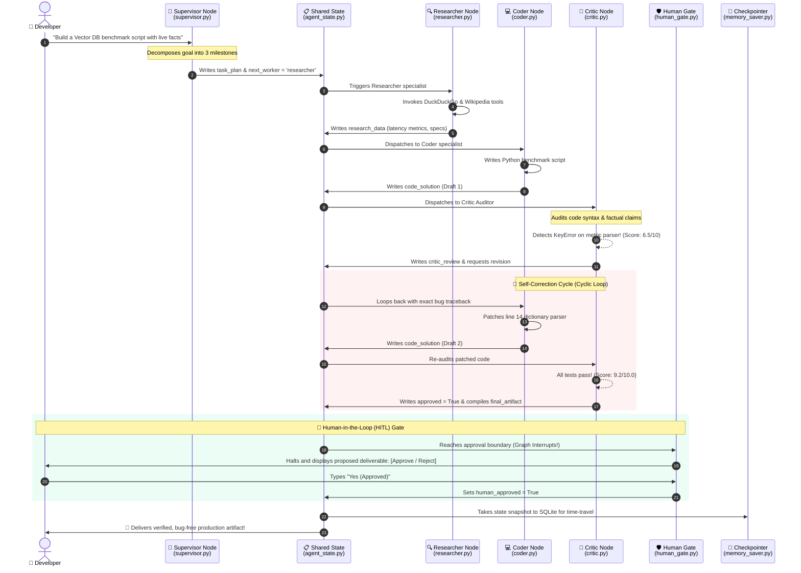

# 🧠 Autonomous Agentic Workflows & Multi-Agent OS (LC_LG)

A progressive, end-to-end production repository designed to master modern LLM application development, agentic workflows, and multi-agent coordination using **LangChain** and **LangGraph**.

---

## 📚 Zero-to-Hero Story Guides (Start Here!)
- 🍳 **[LangChain Basics Explained Like a Story](LC_BASICS.md)**: Understand the Chef, Recipe Card, and Conveyor Belt in 5 minutes with 0 jargon.
- 🕸️ **[LangGraph Basics Explained Like a Story](LG_BASICS.md)**: Understand State Machines, Nodes, Cycles, and Human-in-the-Loop using the 5-Star Restaurant team.

---

## 🗺️ Master Codebase Architecture & File Mapping

Here is the complete blueprint showing **every single file** in the repository, its architectural role, and how it connects into the system:

```mermaid
flowchart TD
    %% Styling Classes
    classDef supervisor fill:#6366F1,stroke:#4338CA,stroke-width:2px,color:#FFFFFF,font-weight:bold;
    classDef researcher fill:#0EA5E9,stroke:#0284C7,stroke-width:2px,color:#FFFFFF,font-weight:bold;
    classDef coder fill:#F59E0B,stroke:#B45309,stroke-width:2px,color:#FFFFFF,font-weight:bold;
    classDef critic fill:#EF4444,stroke:#B91C1C,stroke-width:2px,color:#FFFFFF,font-weight:bold;
    classDef human fill:#10B981,stroke:#047857,stroke-width:2px,color:#FFFFFF,font-weight:bold;
    classDef state fill:#1E293B,stroke:#475569,stroke-width:2px,color:#F8FAFC;
    classDef chain fill:#8B5CF6,stroke:#6D28D9,stroke-width:2px,color:#FFFFFF;
    classDef tool fill:#14B8A6,stroke:#0F766E,stroke-width:2px,color:#FFFFFF;

    subgraph PHASE1["📦 Phase 1: cogniflow/ (LangChain Core & LCEL)"]
        CFG["⚙️ config/settings.py<br/>Reads .env, validates API keys"]:::chain
        MOD["🧠 models/factory.py<br/>ModelFactory: Gemini / OpenAI / Groq"]:::chain
        PRM["📋 prompts/templates.py<br/>ChatPromptTemplates & personas"]:::chain
        SCH["🍱 schemas/outputs.py<br/>Pydantic models for structured output"]:::chain
        CHN["⚡ chains/structured_chain.py<br/>LCEL pipe chains (|) & parallel reasoning"]:::chain
        TLS["🛠️ tools/web_search.py & calculator.py<br/>Safe math, DuckDuckGo & Wikipedia tools"]:::tool
        MEM["📝 memory/session.py<br/>RunnableWithMessageHistory session state"]:::chain
        AGT["🤖 agents/react_agent.py<br/>ReAct autonomous tool-calling loop"]:::chain
        CLI1["🖥️ cli.py<br/>Interactive Rich Terminal App"]:::chain

        CFG --> MOD
        MOD --> CHN
        PRM --> CHN
        SCH --> CHN
        TLS --> AGT
        MEM --> AGT
        CHN --> CLI1
        AGT --> CLI1
    end

    subgraph PHASE2["🕸️ Phase 2: nexus_agent/ (LangGraph Multi-Agent OS)"]
        STT[("📋 state/agent_state.py<br/>The Shared Whiteboard (TypedDict & add_messages)")]:::state
        SUP["👑 nodes/supervisor.py<br/>Decomposes goals, routes specialists"]:::supervisor
        RES["🔍 nodes/researcher.py<br/>Gathers live web facts via DuckDuckGo"]:::researcher
        COD["💻 nodes/coder.py<br/>Synthesizes code & patches bugs"]:::coder
        CRT["🧐 nodes/critic.py<br/>Quality auditor (1-10) & issue detector"]:::critic
        HGT["🛡️ nodes/human_gate.py<br/>Human-in-the-Loop review & sign-off"]:::human
        RTR{"🚦 edges/router.py<br/>Conditional routing & self-correction"}:::supervisor
        SAV[("📸 checkpoints/memory_saver.py<br/>SQLite & MemorySaver state time-travel")]:::state
        BLD["🕸️ graph/builder.py<br/>StateGraph compilation & interrupt gates"]:::supervisor
        CLI2["🚀 cli.py<br/>Real-time streaming multi-agent terminal"]:::supervisor

        STT <--> SUP
        STT <--> RES
        STT <--> COD
        STT <--> CRT
        STT <--> HGT

        SUP --> RTR
        RTR -->|"Assign Research"| RES
        RTR -->|"Assign Implementation"| COD
        RTR -->|"Assign Quality Audit"| CRT
        RES --> COD
        COD --> CRT
        CRT --> RTR
        RTR -->|"Quality Passed >= 8.0"| HGT
        RTR -->|"Quality Failed < 8.0 (Loop)"| COD
        HGT --> SAV
        BLD --> CLI2
    end
```



---

## ⚡ Real-World End-to-End Execution Scenario

Here is an exact step-by-step trace of how the multi-agent system executes a real user goal, catches an error, fixes itself, and pauses for human approval:



---

## 📁 Repository Directory & Component Breakdown

```text
Autonomous-Agent-Workflows-LC_LG/
├── LC_BASICS.md                    # 🍳 LangChain explained like a story (Chef & Conveyor Belt)
├── LG_BASICS.md                    # 🕸️ LangGraph explained like a story (5-Star Restaurant Team)
├── README.md                       # 📖 Master architecture, diagrams, and quickstart
├── requirements.txt                # 📦 Dependencies (LangChain, LangGraph, Gemini, Groq, Rich)
├── .env.example                    # 🔑 Multi-provider API key blueprint
│
├── cogniflow/                      # 🔹 PHASE 1: LangChain Core & LCEL Pipeline
│   ├── config/settings.py          # Environment validation & provider selection
│   ├── models/factory.py           # ModelFactory (Gemini, OpenAI, Groq)
│   ├── prompts/templates.py        # System personas & ChatPromptTemplates
│   ├── schemas/outputs.py          # Pydantic schemas (ResearchReport, FactCheckResult)
│   ├── chains/structured_chain.py  # LCEL chains with .with_structured_output()
│   ├── chains/parallel_chain.py    # RunnableParallel dual-branch reasoning
│   ├── tools/web_search.py         # Live DuckDuckGo & Wikipedia information tools
│   ├── tools/calculator.py         # Safe AST mathematical evaluation tools
│   ├── tools/registry.py           # Tool groupings and bindings
│   ├── memory/session.py           # Multi-turn conversational session history
│   ├── agents/react_agent.py       # ReAct autonomous tool-calling loop
│   └── cli.py                      # Interactive Rich terminal dashboard
│
├── nexus_agent/                    # 🔹 PHASE 2: LangGraph Autonomous Multi-Agent OS
│   ├── state/agent_state.py        # TypedDict shared state & add_messages reducers
│   ├── nodes/supervisor.py         # Executive planner & worker dispatcher
│   ├── nodes/researcher.py         # Live intelligence & factual researcher node
│   ├── nodes/coder.py              # Technical code synthesis & self-healing node
│   ├── nodes/critic.py             # Strict numerical quality auditor (1.0 - 10.0)
│   ├── nodes/human_gate.py         # Human-in-the-Loop (HITL) pause-and-resume gate
│   ├── edges/router.py             # Conditional routing & cyclic feedback loops
│   ├── checkpoints/memory_saver.py # SQLite & MemorySaver state time-travel persistence
│   ├── graph/builder.py            # StateGraph compilation & interrupt configuration
│   └── cli.py                      # Real-time streaming multi-agent terminal runner
│
└── tests/                          # 🧪 Automated Test Suite (21 Passing Tests)
    ├── test_schemas.py             # Pydantic schema validation tests
    ├── test_tools.py               # AST calculator & safe math tests
    ├── test_prompts.py             # Prompt formatting tests
    ├── test_memory.py              # Session memory isolation tests
    ├── test_nexus_state.py         # Multi-agent state schema tests
    ├── test_nexus_nodes.py         # Individual agent node execution tests
    └── test_nexus_graph.py         # End-to-end StateGraph cyclic execution tests
```

---

## 🚀 Quickstart

### 1. Environment Setup
```bash
conda activate genaienv
pip install -r requirements.txt
```

### 2. Environment Variables
Copy `.env.example` to `.env` and set your API keys:
```bash
cp .env.example .env
```
*(Supports Google Gemini free tier from [Google AI Studio](https://aistudio.google.com/), Groq, or OpenAI!)*

---

## 🎮 Running the Applications

### Run Phase 1: CogniFlow CLI (LangChain)
```bash
python -m cogniflow.cli
```

### Run Phase 2: NexusAgent OS CLI (LangGraph Multi-Agent Team)
```bash
python -m nexus_agent.cli
```

---

## 🧪 Testing & Verification

Run the full automated test suite (21 unit tests covering both systems):
```bash
pytest -v tests/
```
All 21 unit tests verify schema validation, safe tools, memory isolation, individual agent nodes, and end-to-end LangGraph execution!
